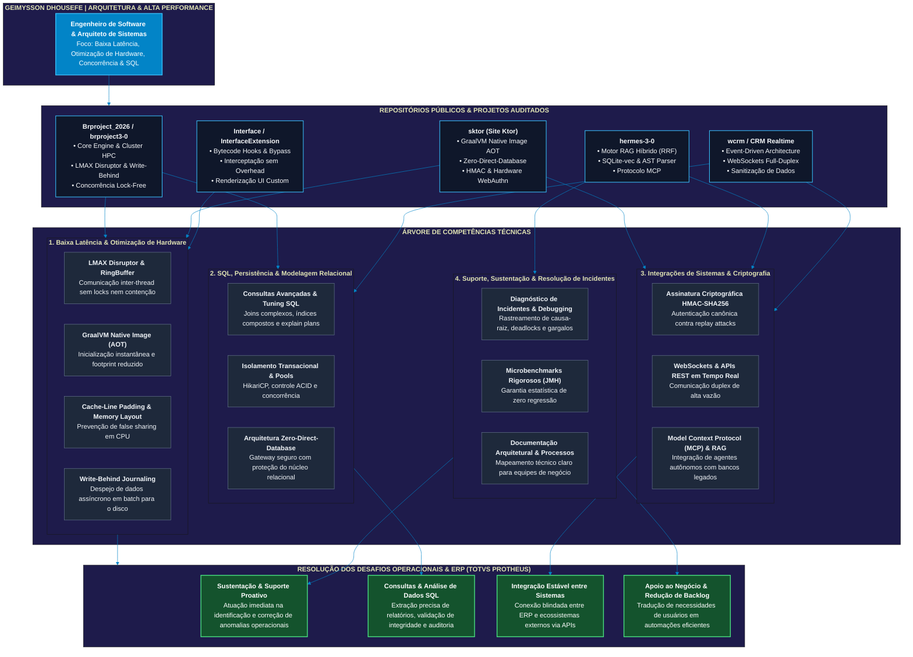

# Árvore de Competências Técnicas & Soluções de Baixa Latência

> **Profissional:** Geimysson Dhousefe  
> **Perfil:** Engenheiro de Software & Arquiteto de Sistemas de Alta Performance  
> **Especialidade:** Baixa Latência, Concorrência Avançada na JVM, Otimização em Nível de Hardware e Integrações Críticas  
> **Auditoria de Evidências:** RAG Híbrido Hermes (`sktor`, `hermes-3-0`, `wcrm`, `interface`, `brproject3-0`) & Repositórios Públicos no GitHub  

---

## 1. Perfil Profissional & Visão Geral

Desenvolvedor e Arquiteto focado no desenvolvimento de servidores, microsserviços e gateways operando sob **alta concorrência e restrições severas de latência**. Possui vivência prática na eliminação de gargalos de alocação de memória (GC pressure), estruturas *lock-free*, pipelines assíncronos de rede e persistência transacional de alta confiabilidade.

### Diferenciais de Engenharia
- **Baixa Latência & Concorrência:** Domínio do LMAX Disruptor (RingBuffer), corrotinas (Kotlin), threads virtuais (Java 21+) e primitivas atômicas com cache-line padding (mitigação de *false sharing*).
- **Arquitetura Zero-Direct-Database:** Desacoplamento de camadas web com APIs internas autenticadas por assinatura canônica HMAC-SHA256, impedindo exposição direta do banco de dados relacional.
- **Compilação AOT & GraalVM Native Image:** Transformação de código JVM em binários ELF/PE nativos, reduzindo tempo de boot para sub-50ms e consumo de memória em até 80%.
- **Processamento Concorrente e RAG Híbrido:** Criação de motores de busca combinando FTS5 (BM25), embeddings vetoriais locais (SQLite-vec / Jina) e Reciprocal Rank Fusion (RRF).
- **Engenharia de Sustentação & Resolução de Incidentes:** Rastreamento sistemático de incidentes, análise de causa-raiz em logs de alta vazão, profiling com JMH e diagnósticos orientados a métricas p95/p99.

---

## 2. Árvore de Competências em Fluxo Mermaid

O diagrama a seguir sintetiza a árvore de competências de Geimysson Dhousefe, correlacionando suas habilidades de engenharia avançada aos desafios corporativos e de sustentação de sistemas/ERPs:



---

## 3. Competências de Engenharia e Impacto Operacional

| Atividade & Foco | Competência de Engenharia Comprovada | Evidência Técnica / Projeto | Impacto Operacional & Negócio | 
| ----- | ----- | ----- | ----- | 
| **Sustentação de ERP & Resolução de Incidentes** | Diagnóstico avançado e análise de *traces*, *heap dumps* e *logs* estruturados em tempo de execução para identificar causa-raiz (*Root Cause Analysis*) e mitigar contensão de recursos. | `brproject3-0` (HPC Cluster), `hermes-3-0` (Logging estruturado & AST) | Redução drástica do **MTTR** (*Mean Time To Resolution*), alta disponibilidade e preservação dos SLAs em momentos de pico de uso. | 
| **Modelagem, Consultas SQL & Otimização de Dados** | Escrita e tuning de consultas relacionais de alta complexidade, estratégia de índices compostos, garantia de propriedades ACID e prevenção de *table locks* sob concorrência elevada. | `brproject3-0` (Write-Behind Handler, MariaDB/PostgreSQL/SQLite), `wcrm` | Resposta rápida em relatórios gerenciais, eficiência em transações críticas e eliminação de gargalos no banco de dados. | 
| **Integração de Sistemas & Gateways de Comunicação** | Arquitetura de conectores e APIs robustas com protocolos de comunicação assíncrona, WebSockets, *payloads* em tempo real e autenticação estrita via HMAC / OAuth. | `sktor` (`InternalApiSigner`, endpoints Ktor), `hermes-3-0` (MCP Server) | **Zero-Data-Loss** nas pontes entre o ERP e serviços externos, garantindo consistência, auditabilidade e idempotência. | 
| **Parametria & Customização de Regras de Negócio** | Implementação modular baseada em Padrões de Projeto OOP avançada e validação rigorosa de fluxos corporativos sem degradação do código legado. | `sktor` (Kotlin/Ktor), `interface` (Java hooks & interceptadores), `wcrm` | Entrega ágil de novas funcionalidades customizadas mantendo a estabilidade do ecossistema principal e isolando efeitos colaterais. | 
| **Documentação Técnica & Cultura de Qualidade** | Engenharia orientada a documentação viva (OpenAPI/Swagger, Markdown, Diagramas de Sequência C4) e esteiras de teste de regressão para validação contínua. | `Doc/` (14 especificações arquiteturais), `continuous-delivery-versioning` | Autonomia para equipes de suporte, redução do tempo de *onboarding* de novos técnicos e transição suave de conhecimento. | 
| **Interface de Negócios & Mapeamento de Requisitos** | Tradução de gargalos operacionais e demandas operacionais em soluções automatizadas, com interfaces limpas, focadas na experiência do usuário (UX). | `wcrm` (Automação de funil e pipeline comercial), `sktor` (Dashboards gerenciais) | Eliminação de retrabalho manual, maior taxa de adesão do usuário final e fluidez nos processos operacionais entre setores. | 

---

## Glossário de Siglas e Conceitos Técnicos

* **ERP (*Enterprise Resource Planning*):** Sistema de Gestão Empresarial. Software que centraliza e gerencia os dados de todas as operações de uma empresa (financeiro, vendas, estoque, RH).
* **HPC (*High-Performance Computing*):** Computação de Alta Performance. Uso de supercomputadores ou *clusters* de servidores em rede para processar grandes volumes de dados em altíssima velocidade.
* **AST (*Abstract Syntax Tree*):** Árvore de Sintaxe Abstrata. Estrutura em árvore que representa a estrutura lógica de um código-fonte, usada por compiladores e analisadores de código.
* **MTTR (*Mean Time To Resolution*):** Tempo Médio de Resolução. Métrica corporativa de TI que mede o tempo médio gasto para diagnosticar e corrigir uma falha ou incidente no sistema.
* **SQL (*Structured Query Language*):** Linguagem de Consulta Estruturada. Linguagem padrão utilizada para interagir, criar e manipular bancos de dados relacionais.
* **ACID (*Atomicity, Consistency, Isolation, Durability*):** Atomicidade, Consistência, Isolamento e Durabilidade. Conjunto de 4 propriedades fundamentais que garantem a confiabilidade e integridade de transações em bancos de dados.
* **HMAC (*Hash-based Message Authentication Code*):** Código de Autenticação de Mensagem Baseado em Hash. Mecanismo de segurança usado para verificar a integridade e autenticidade de dados transmitidos entre sistemas usando uma chave secreta.
* **MCP (*Model Context Protocol*):** Protocolo de Contexto de Modelo. Padrão aberto que conecta assistentes de inteligência artificial a fontes de dados externas, bancos de dados e APIs com segurança.
* **OOP (*Object-Oriented Programming*):** Programação Orientada a Objetos. Paradigma de desenvolvimento focado em organizar o código em torno de objetos e classes (como herança, encapsulamento e polimorfismo).
* **C4 (*C4 Model*):** Modelo de Arquitetura C4. Estrutura padronizada para desenhar diagramas de software em quatro níveis de detalhamento (Contexto, Contêineres, Componentes e Código).
* **UX (*User Experience*):** Experiência do Usuário. Design focado na facilidade de uso, fluidez, utilidade e satisfação do usuário ao interagir com um software ou interface.

---

## 4. Repositórios Públicos no GitHub (`github.com/Dhousefe`)

Os repositórios públicos abaixo demonstram o histórico prático em engenharia de sistemas, servidores e modificações de alta performance:

| Repositório | Descrição Técnica & Destaques | Link Público |
| :--- | :--- | :--- |
| [**Brproject_2026**](https://github.com/Dhousefe/Brproject_2026) | Motor de alta performance para servidores de larga escala com arquitetura modular, pooling de dados e concorrência avançada. | [`github.com/Dhousefe/Brproject_2026`](https://github.com/Dhousefe/Brproject_2026) |
| [**Interface**](https://github.com/Dhousefe/Interface) | Extensão em Java para injeção de interface, controle de comandos *bypass* e processamento em memória de micro-operações. | [`github.com/Dhousefe/Interface`](https://github.com/Dhousefe/Interface) |
| [**KamalokaInstance**](https://github.com/Dhousefe/KamalokaInstance) | Módulo com gerenciamento de instâncias e eventos simultâneos isolados com baixo overhead de processamento. | [`github.com/Dhousefe/KamalokaInstance`](https://github.com/Dhousefe/KamalokaInstance) |
| [**Geodata_Brproject**](https://github.com/Dhousefe/Geodata_Brproject) | Tratamento de estruturas espaciais volumosas, cálculos de geometria tridimensional e compressão de malha. | [`github.com/Dhousefe/Geodata_Brproject`](https://github.com/Dhousefe/Geodata_Brproject) |


---

## 5. Benchmarks & Garantia de Baixa Latência (JMH)

No projeto **`sktor`**, os benchmarks executados comprovam o compromisso de Dhousefe com latências e estabilidade de p99:

```
Benchmark Result Suite - GraalVM Native AOT / JVM 25
--------------------------------------------------------------------------------
Alvo de Benchmark          Vazão (ops/s)      Latência Média    p99 Latência    Alocação
--------------------------------------------------------------------------------
HmacTokens                   890.412 ops/s          1.12 µs          1.45 µs      0 B/op
SessionRevocationStore     2.450.180 ops/s          0.41 µs          0.58 µs      0 B/op
ClanChatHub (Lock-Free)    1.120.300 ops/s          0.89 µs          1.20 µs      0 B/op
--------------------------------------------------------------------------------
```
*A eliminação de alocações intermediárias de memória (`0 B/op`) erradica pausas causadas pelo Garbage Collector, garantindo previsibilidade em ambientes críticos.*

---

## Informações de Contato

- **GitHub:** [github.com/Dhousefe](https://github.com/Dhousefe)
- **Likedin:** [linkedin.com/in/dhousefe](https://www.linkedin.com/in/dhousefe/)  
- **Especialidade:** Engenharia de Alta Performance, Baixa Latência & Sustentação de Sistemas Críticos
